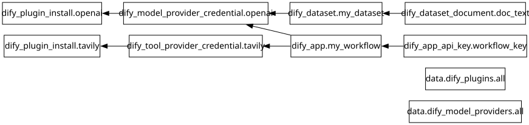

> This is a demo project
# Dify Terraform Provider (Unofficial)

[](https://github.com/wylswz/dify-unofficial-terraform-provider/actions/workflows/test.yml)
[](https://goreportcard.com/report/github.com/wylswz/dify-unofficial-terraform-provider)
[](LICENSE)

A Terraform provider for managing [Dify](https://dify.ai) applications, model and tool provider credentials, plugin installs, and app API keys as infrastructure-as-code.

The provider talks to Dify's user-scoped OpenAPI (`/openapi/v1`) and authenticates with a **Personal Access Token (PAT)**

## Requirements

- [Terraform](https://www.terraform.io/downloads.html) >= 1.0
- [Go](https://go.dev/dl/) — see `go.mod` for the required version (to build the provider)
- A Dify instance exposing the `/openapi/v1` API. The provider is acceptance-tested
  against upstream [langgenius/dify](https://github.com/langgenius/dify) at the
  commit pinned in [`scripts/dify-commit`](scripts/dify-commit).

## Personal Access Token

Create a PAT in the Dify console: **account settings → Personal Access Tokens**. The token acts as your user account, so it must have access to the workspace you manage — including workspace-scoped permissions for the operations you run (app import/export, credential management, plugin install, and so on). Treat it like a password.

Pass the token to the provider through the `DIFY_TOKEN` environment variable (or a sensitive Terraform variable) rather than hardcoding it — the provider token itself is not persisted in state. Resource-level secrets are different: values Dify only returns once, such as `dify_app_api_key` tokens, credential secrets, and MCP headers, **are** marked `Sensitive` but still persist in Terraform state and plan files. Never share raw state or plan output.

## Installing the Provider

Until the provider is published on the Terraform Registry, install a release binary into the local plugin mirror — this one-liner detects your OS/arch (Linux/macOS, amd64/arm64):

```bash
VERSION=0.0.1; VERSION=${VERSION#v}; OS=$(uname -s | tr '[:upper:]' '[:lower:]'); ARCH=$(uname -m | sed 's/x86_64/amd64/;s/aarch64/arm64/'); \
  curl -sL "https://github.com/wylswz/dify-unofficial-terraform-provider/releases/download/v${VERSION}/terraform-provider-dify_${VERSION}_${OS}_${ARCH}.zip" -o /tmp/dify-tf.zip \
  && mkdir -p "$HOME/.terraform.d/plugins/registry.terraform.io/wylswz/dify/${VERSION}/${OS}_${ARCH}" \
  && unzip -o /tmp/dify-tf.zip -d "$HOME/.terraform.d/plugins/registry.terraform.io/wylswz/dify/${VERSION}/${OS}_${ARCH}" \
  && rm /tmp/dify-tf.zip
```

Or build from source with `make install-local` (see [Developing the Provider](#developing-the-provider)).

## Quick Start

```hcl
terraform {
  required_providers {
    dify = {
      source  = "registry.terraform.io/wylswz/dify"
      version = "0.0.1"
    }
  }
}

provider "dify" {
  host         = "https://dify.example.com"
  token        = var.dify_token
  workspace_id = var.dify_workspace_id
}
```

A full end-to-end setup — model credentials with load balancing, tool providers, published workflow tools, and an agent orchestrator — lives in [`examples/complete/`](examples/complete/).

## Provider Configuration

| Attribute | Environment Variable | Description | Required |
|---|---|---|---|
| `host` | `DIFY_HOST` | Dify base URL; the provider calls `<host>/openapi/v1` | No (defaults to `http://localhost`) |
| `token` | `DIFY_TOKEN` | Personal Access Token (`Authorization: Bearer`) | Yes |
| `workspace_id` | `DIFY_WORKSPACE_ID` | Workspace ID for resource operations; defaults to the token owner's default workspace (`GET /openapi/v1/account`) | No |

The server rate-limits each token on `/openapi/v1` (`OPENAPI_RATE_LIMIT_PER_TOKEN`, default 60 requests/minute). The provider automatically backs off and retries on HTTP 429 using the response's `Retry-After` header.



## Resources

Full, generated attribute-level specs for every resource and data source live in [`docs/`](docs/) ([`docs/resources/`](docs/resources/), [`docs/data-sources/`](docs/data-sources/)) — the same documentation the Terraform Registry renders. The sections below are a summary.

### `dify_app`

Manages a Dify application via DSL YAML content. The app lifecycle (create, update, delete) is driven by importing the DSL through the workspace OpenAPI.

```hcl
resource "dify_app" "my_workflow" {
  dsl_yaml    = file("my-workflow.yaml")
  name        = "My Workflow"
  description = "A workflow managed by Terraform"
}
```

| Attribute | Type | Description |
|---|---|---|
| `dsl_yaml` | String (required) | DSL YAML content defining the app |
| `name` | String (optional) | Override app name from DSL |
| `description` | String (optional) | Override app description from DSL |
| `id` | String (computed) | App ID |
| `mode` | String (computed) | App mode (`chat`, `workflow`, `agent-chat`, etc.), read from the exported DSL |
| `exported_dsl_yaml` | String (computed) | DSL YAML exported from the live app |
| `draft_hash` | String (computed) | Draft hash returned by the export; sent back on overwrite imports |
| `publish` | Bool (optional, default `false`) | Publish the app after create/update (`POST /apps/{id}:publish`). Only `workflow`/`advanced-chat` apps have drafts — other modes are live on import and `publish` is ignored |
| `service_api_enabled` | Bool (optional, computed) | Enable the app's service API endpoint; read back from the server. Setting `false` is rejected: this server's management calls (DSL export, publish, versions) require the Service API |

**Replace-on-update caveat**: the OpenAPI only overwrites `workflow` and `advanced-chat` apps in place. For apps of any other mode (`chat`, `agent-chat`, `completion`, `agent`), changing `dsl_yaml`, `name`, or `description` **replaces** the app (delete + create) — plan accordingly, since replacement generates a new app ID.

The resource can be imported by app ID: `terraform import dify_app.my_app <app_id>`.

### `dify_model_provider_credential`

Manages model provider credentials (e.g. an OpenAI API key). `provider_name` is the provider path, e.g. `langgenius/openai/openai`.

```hcl
resource "dify_model_provider_credential" "openai" {
  provider_name = "langgenius/openai/openai"
  name          = "production-key"
  credentials = {
    openai_api_key = "sk-..."
  }
}
```

| Attribute | Type | Description |
|---|---|---|
| `provider_name` | String (required) | Model provider id (forces replacement if changed) |
| `credentials` | Map (required, sensitive) | Credential key-value pairs; write-only — the API never returns secret values, so state keeps the configured values |
| `name` | String (optional) | Human-readable name |
| `make_active` | Bool (optional) | Switch the provider's active credential to this one after create/update |
| `credential_id` | String (computed) | Credential ID |
| `active` | Bool (computed) | Whether this is the provider's active credential |

### `dify_model_credential`

Manages a credential for an individual model (custom-model credentials), e.g. a per-model API key. Identified by `provider_name` + `model` + `model_type`.

```hcl
resource "dify_model_credential" "gpt4o_mini" {
  provider_name = "langgenius/openai/openai"
  model         = "gpt-4o-mini"
  model_type    = "llm"
  name          = "per-model-key"
  credentials = {
    api_key = "sk-..."
  }
}
```

| Attribute | Type | Description |
|---|---|---|
| `provider_name` | String (required) | Model provider id (forces replacement) |
| `model` | String (required) | Model name (forces replacement) |
| `model_type` | String (required) | `llm`, `text-embedding`, `rerank`, `speech2text`, `tts` (forces replacement) |
| `credentials` | Map (required, sensitive) | Credential key-value pairs; write-only |
| `name` | String (optional) | Human-readable name |
| `make_active` | Bool (optional) | Make this the model's active credential after create/update |
| `credential_id` | String (computed) | Credential ID |
| `active` | Bool (computed) | Whether this is the model's active credential |

### `dify_default_model`

Sets the workspace default model for a model type (e.g. the default LLM).

```hcl
resource "dify_default_model" "llm" {
  model_type    = "llm"
  provider_name = "langgenius/openai/openai"
  model         = "gpt-4o-mini"
}
```

| Attribute | Type | Description |
|---|---|---|
| `model_type` | String (required) | Model type (forces replacement) |
| `provider_name` | String (required) | Provider of the default model |
| `model` | String (required) | Model name |

**Delete caveat**: the API has no "unset default" operation, so `terraform destroy` only removes the resource from state — the server-side default is left unchanged.

### `dify_model_settings`

Manages a model's enabled state and load-balancing pool declaratively.

```hcl
resource "dify_model_settings" "gpt4o_mini" {
  provider_name          = "langgenius/openai/openai"
  model                  = "gpt-4o-mini"
  model_type             = "llm"
  config_from            = "predefined-model"
  load_balancing_enabled = true

  load_balancing_entries = [
    { enabled = true },                                                   # inherit the model's active credential
    { credential_id = dify_model_credential.backup.credential_id, enabled = true },
  ]
}
```

| Attribute | Type | Description |
|---|---|---|
| `provider_name` | String (required) | Model provider id (forces replacement) |
| `model` | String (required) | Model name (forces replacement) |
| `model_type` | String (required) | Model type (forces replacement) |
| `config_from` | String (required) | `predefined-model` or `custom-model` — which credential table the entries reference (forces replacement) |
| `enabled` | Bool (optional, default `true`) | Whether the model is enabled |
| `load_balancing_enabled` | Bool (optional, default `false`) | Enable load balancing across entries |
| `load_balancing_entries` | List (optional) | `{ credential_id, enabled }` — `credential_id` null/absent means the inherit entry |

Delete resets the model to `enabled = true`, load balancing disabled, no entries.

### `dify_api_tool_provider`

Manages a custom OpenAPI-schema tool provider.

```hcl
resource "dify_api_tool_provider" "open_meteo" {
  name        = "open_meteo"
  icon        = { content = "⛅", background = "#E0F2FE" }
  schema_type = "openapi"
  schema      = file("openapi.json")
  credentials = { auth_type = "none" }
}
```

| Attribute | Type | Description |
|---|---|---|
| `name` | String (required) | Provider name — renaming applies in place via PUT |
| `icon` | Object (required) | `{ content, background }` |
| `schema_type` | String (optional, default `openapi`) | Schema format |
| `schema` | String (required) | OpenAPI schema document |
| `credentials` | Map (optional, sensitive) | Auth config, e.g. `{ auth_type = "none" }`; write-only — describe returns masked values |
| `privacy_policy` | String (optional) | Privacy policy URL |
| `custom_disclaimer` | String (optional) | Disclaimer text |
| `labels` | List (optional) | Labels |
| `tools` | List (computed) | Tool names the schema produced |

Import by name: `terraform import dify_api_tool_provider.x <name>`.

### `dify_mcp_provider`

Manages an MCP (Model Context Protocol) tool provider.

```hcl
resource "dify_mcp_provider" "deepwiki" {
  name              = "deepwiki"
  server_url        = "https://mcp.deepwiki.com/mcp"
  server_identifier = "deepwiki"
  icon              = "🌐"
  icon_type         = "emoji"
}
```

| Attribute | Type | Description |
|---|---|---|
| `name` | String (required) | Provider name |
| `server_url` | String (required, sensitive) | MCP endpoint; write-only — describe masks it |
| `server_identifier` | String (optional) | Server identifier slug |
| `icon`, `icon_type`, `icon_background` | String (optional) | Icon (`icon_type` defaults to `emoji`) |
| `headers` | Map (optional, sensitive) | Extra request headers; write-only |
| `timeout`, `sse_read_timeout` | Number (optional) | Connection timeouts via `configuration` |
| `id` | String (computed) | Provider ID |
| `tools` | List (computed) | Tool names fetched from the server |

After create/update, if the server reported no tools the provider calls `:refresh` once and records them. Import by ID: `terraform import dify_mcp_provider.x <id>`.

### `dify_workflow_tool`

Publishes a workflow app as a workspace tool. The workflow app must be published first (`dify_app` with `publish = true`).

```hcl
resource "dify_workflow_tool" "web_research" {
  workflow_app_id = dify_app.research.id
  name            = "web_research"
  label           = "Web Research"
  description     = "Research a question on the web"
  icon            = { content = "🔎", background = "#FFEAD5" }
  parameters = [
    { name = "query", description = "The question to research", form = "llm" },
  ]
}
```

| Attribute | Type | Description |
|---|---|---|
| `workflow_app_id` | String (required) | App to publish as a tool (forces replacement) |
| `name` | String (required) | Tool name (agent-visible identifier) |
| `label` | String (required) | Display label |
| `description` | String (required) | Tool description |
| `icon` | Object (required) | `{ content, background }` |
| `parameters` | List (required) | `{ name, description, form }` — `form` defaults to `llm` |
| `privacy_policy` | String (optional) | Privacy policy URL |
| `labels` | List (optional) | Labels |
| `id` | String (computed) | Workflow tool ID |

Delete unpublishes the tool. Import by tool ID: `terraform import dify_workflow_tool.x <id>`.

### `dify_tool_provider_credential`

Manages builtin tool provider credentials (e.g. a Tavily API key). Same shape as the model credential resource; `name` is limited to 30 characters by the API.

```hcl
# Install the plugin first
resource "dify_plugin_install" "tavily" {
  plugin_unique_identifier = "langgenius/tavily:0.1.7@5fce9cf01fecda9ad92e5125397d2bb5497429baed276c7f14f033e7debd0abe"
}

# Then configure credentials
resource "dify_tool_provider_credential" "tavily" {
  provider_name = "langgenius/tavily/tavily"
  name          = "production-key"
  credentials = {
    tavily_api_key = "tvly-..."
  }

  depends_on = [dify_plugin_install.tavily]
}
```

| Attribute | Type | Description |
|---|---|---|
| `provider_name` | String (required) | Tool provider id — for plugins use the full path `langgenius/tavily/tavily` |
| `credentials` | Map (required, sensitive) | Credential key-value pairs; write-only |
| `name` | String (optional) | Human-readable name (max 30 chars) |
| `credential_id` | String (computed) | Credential ID |
| `active` | Bool (computed) | Whether this is the provider's default credential |

### `dify_plugin_install`

Manages a plugin installation from the marketplace. Installation is asynchronous; the resource polls the install task until it finishes.

```hcl
resource "dify_plugin_install" "openai" {
  plugin_unique_identifier = "langgenius/openai:0.3.8@592c8252795b5f75807de2d609a03196ed02596b409f7642b4a07548c7ff57ef"
}
```

| Attribute | Type | Description |
|---|---|---|
| `plugin_unique_identifier` | String (required) | Versioned marketplace identifier (`name:version@sha256`) |
| `plugin_id` | String (computed) | Plugin ID (`langgenius/openai`) |
| `version` | String (computed) | Installed version |
| `category` | String (computed) | Plugin category (`model`, `tool`, …) |

### `dify_app_api_key`

Manages an API key for a Dify application.

```hcl
resource "dify_app_api_key" "key" {
  app_id = dify_app.my_workflow.id
}
```

| Attribute | Type | Description |
|---|---|---|
| `app_id` | String (required) | App ID (forces replacement if changed) |
| `key_id` | String (computed) | API key ID |
| `token` | String (computed, sensitive) | API key token |
| `created_at` | String (computed) | Creation timestamp (RFC3339) |

## Data Sources

### `dify_app`

Reads a Dify application by `id` or exact `name` (exactly one required).

```hcl
data "dify_app" "existing" {
  id = "abc-123-def"
}
```

Returns `id`, `name`, `mode`, `description`, and `updated_at`.

### `dify_plugins`

Lists all plugins installed in the workspace.

```hcl
data "dify_plugins" "all" {}
```

Each entry exposes `plugin_id`, `identifier`, `version`, `category`, and `source`.

### `dify_models`

Lists models available in the workspace, with optional `provider_name` and `model_type` filters.

```hcl
data "dify_models" "openai_llms" {
  provider_name = "langgenius/openai/openai"
  model_type    = "llm"
}
```

Each entry exposes `provider`, `model`, `model_type`, and `status`.

### `dify_tools`

Lists tools a workflow can call in the workspace, each with the server-provided tool-node template. Use `node_data` (JSON) to inject the exact `provider_id`/`provider_name`/`plugin_unique_identifier` a tool node's DSL expects.

```hcl
data "dify_tools" "deepwiki" {
  provider_name = dify_mcp_provider.deepwiki.id
}

data "dify_tools" "search" {
  query = "search"
}
```

| Argument | Description |
|---|---|
| `provider_name` | Optional provider filter (the provider's `id`, e.g. `langgenius/tavily/tavily` or an MCP provider ID) |
| `query` | Optional words matched against tool name, label, provider id, or provider label |

Each `tools` entry exposes `provider`, `provider_type`, `name`, `label`, and `node_data` (JSON string).

## Datasets

Dataset and dataset-document management is **not yet supported** by this provider.

## Developing the Provider

```bash
make build      # compile the provider
make install    # install into $GOBIN for dev_overrides
make test       # unit tests (httptest-based, no Dify needed)
make testacc    # acceptance tests against a live Dify (needs TF_ACC=1 + DIFY_*)

# or end-to-end against a real upstream Dify stack pinned to scripts/dify-commit:
bash scripts/dify-acceptance.sh [path/to/local/dify-repo]
make lint       # golangci-lint
make generate   # terraform fmt examples + regenerate docs/ via tfplugindocs
```

See [`CONTRIBUTING.md`](CONTRIBUTING.md) for the full development workflow, and [`CHANGELOG.md`](CHANGELOG.md) for release notes. Releases are automated with GoReleaser — see [`.github/workflows/release.yml`](.github/workflows/release.yml).

## DSL YAML

The `dify_app` resource uses Dify's DSL YAML format for defining applications. Export an existing app's DSL from the Dify console (or via `GET /openapi/v1/apps/<app_id>/dsl`), save it, and manage it in Terraform:

```hcl
resource "dify_app" "new_app" {
  dsl_yaml = file("exported-app.yaml")
  name     = "Cloned App"
}
```

After apply, `exported_dsl_yaml` holds the server-normalized DSL — useful for reviewing drift between your `dsl_yaml` and what Dify actually stored.

## License

See [LICENSE](LICENSE) for the repository's MIT license text. Files with an
explicit SPDX notice retain the license stated in that notice (currently
`MPL-2.0`; the full MPL-2.0 text is included in [LICENSES/MPL-2.0.txt](LICENSES/MPL-2.0.txt)).
