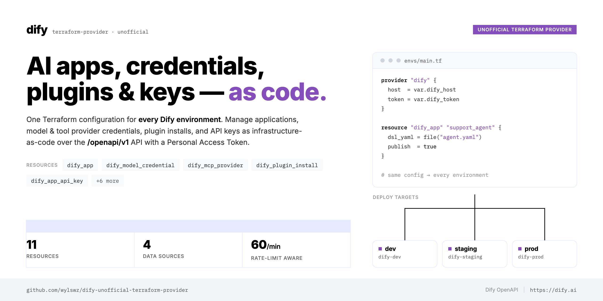

> This is a demo project
# Dify Terraform Provider (Unofficial)

<p align="center">
  
</p>

[](https://github.com/wylswz/dify-unofficial-terraform-provider/actions/workflows/test.yml)
[](https://goreportcard.com/report/github.com/wylswz/dify-unofficial-terraform-provider)
[](LICENSE)

A Terraform provider for managing [Dify](https://dify.ai) applications, datasets, model and tool provider credentials, plugin installs, and app API keys as infrastructure-as-code.

The provider talks to Dify's user-scoped OpenAPI (`/openapi/v1`) and authenticates with a **Personal Access Token (PAT)**

## Requirements

- [Terraform](https://www.terraform.io/downloads.html) >= 1.0
- [Go](https://go.dev/dl/) — see `go.mod` for the required version (to build the provider)
- A Dify instance exposing the `/openapi/v1` API. The provider is acceptance-tested
  against upstream [langgenius/dify](https://github.com/langgenius/dify) at the
  commit pinned in [`scripts/dify-commit`](scripts/dify-commit).

## Personal Access Token

Create a PAT in the Dify console: **account settings → Personal Access Tokens**. The token acts as your user account, so it must have access to the workspace you manage — including workspace-scoped permissions for the operations you run (app import/export, credential management, plugin install, and so on). Treat it like a password.

Pass the token to the provider through the `DIFY_TOKEN` environment variable (or a sensitive Terraform variable) rather than hardcoding it — the provider token itself is not persisted in state. Resource-level secrets are different: values Dify only returns once, such as `dify_app_api_key` tokens, credential secrets, and MCP headers, **are** marked `Sensitive` but still persist in Terraform state and plan files. Never share raw state or plan output.

## Installing the Provider

Until the provider is published on the Terraform Registry, install a release binary into the local plugin mirror — this one-liner detects your OS/arch (Linux/macOS, amd64/arm64):

```bash
VERSION=0.0.1; VERSION=${VERSION#v}; OS=$(uname -s | tr '[:upper:]' '[:lower:]'); ARCH=$(uname -m | sed 's/x86_64/amd64/;s/aarch64/arm64/'); \
  curl -sL "https://github.com/wylswz/dify-unofficial-terraform-provider/releases/download/v${VERSION}/terraform-provider-dify_${VERSION}_${OS}_${ARCH}.zip" -o /tmp/dify-tf.zip \
  && mkdir -p "$HOME/.terraform.d/plugins/registry.terraform.io/wylswz/dify/${VERSION}/${OS}_${ARCH}" \
  && unzip -o /tmp/dify-tf.zip -d "$HOME/.terraform.d/plugins/registry.terraform.io/wylswz/dify/${VERSION}/${OS}_${ARCH}" \
  && rm /tmp/dify-tf.zip
```

Or build from source with `make install-local` (see [Developing the Provider](#developing-the-provider)).

## Quick Start

```hcl
terraform {
  required_providers {
    dify = {
      source  = "registry.terraform.io/wylswz/dify"
      version = "0.0.1"
    }
  }
}

provider "dify" {
  host         = "https://dify.example.com"
  token        = var.dify_token
  workspace_id = var.dify_workspace_id
}
```

A full end-to-end setup — model credentials with load balancing, tool providers, published workflow tools, and an agent orchestrator — lives in [`examples/complete/`](examples/complete/).

## Provider Configuration

| Attribute | Environment Variable | Description | Required |
|---|---|---|---|
| `host` | `DIFY_HOST` | Dify base URL; the provider calls `<host>/openapi/v1` | No (defaults to `http://localhost`) |
| `token` | `DIFY_TOKEN` | Personal Access Token (`Authorization: Bearer`) | Yes |
| `workspace_id` | `DIFY_WORKSPACE_ID` | Workspace ID for resource operations; defaults to the token owner's default workspace (`GET /openapi/v1/account`) | No |

The server rate-limits each token on `/openapi/v1` (`OPENAPI_RATE_LIMIT_PER_TOKEN`, default 60 requests/minute). The provider automatically backs off and retries on HTTP 429 using the response's `Retry-After` header.


## Resources

Full, generated attribute-level specs for every resource and data source live in [`docs/`](docs/) ([`docs/resources/`](docs/resources/), [`docs/data-sources/`](docs/data-sources/)) — the same documentation the Terraform Registry renders.

| Resource | Description |
|---|---|
| [`dify_app`](docs/resources/app.md) | Manage a Dify application via DSL YAML content |
| [`dify_api_tool_provider`](docs/resources/api_tool_provider.md) | Manage a custom OpenAPI-schema tool provider |
| [`dify_app_api_key`](docs/resources/app_api_key.md) | Manage an API key for a Dify application |
| [`dify_dataset`](docs/resources/dataset.md) | Manage a knowledge base (dataset) |
| [`dify_dataset_document`](docs/resources/dataset_document.md) | Manage documents in a dataset |
| [`dify_dataset_document_indexing_wait`](docs/resources/dataset_document_indexing_wait.md) | Wait for dataset document indexing to complete |
| [`dify_default_model`](docs/resources/default_model.md) | Set the workspace default model for a model type |
| [`dify_mcp_provider`](docs/resources/mcp_provider.md) | Manage an MCP tool provider |
| [`dify_model_credential`](docs/resources/model_credential.md) | Manage a credential for an individual model |
| [`dify_model_provider_credential`](docs/resources/model_provider_credential.md) | Manage model provider credentials (e.g. an API key) |
| [`dify_model_settings`](docs/resources/model_settings.md) | Manage a model's enabled state and load-balancing pool |
| [`dify_plugin_install`](docs/resources/plugin_install.md) | Manage a plugin installation from the marketplace |
| [`dify_tool_provider_credential`](docs/resources/tool_provider_credential.md) | Manage builtin tool provider credentials |
| [`dify_workflow_tool`](docs/resources/workflow_tool.md) | Publish a workflow app as a workspace tool |

## Data Sources

| Data Source | Description |
|---|---|
| [`dify_app`](docs/data-sources/app.md) | Read a Dify application by `id` or exact `name` |
| [`dify_models`](docs/data-sources/models.md) | List models available in the workspace |
| [`dify_plugins`](docs/data-sources/plugins.md) | List all plugins installed in the workspace |
| [`dify_tools`](docs/data-sources/tools.md) | List tools a workflow can call in the workspace |

## Developing the Provider

```bash
make build      # compile the provider
make install    # install into $GOBIN for dev_overrides
make test       # unit tests (httptest-based, no Dify needed)
make testacc    # acceptance tests against a live Dify (needs TF_ACC=1 + DIFY_*)

# or end-to-end against a real upstream Dify stack pinned to scripts/dify-commit:
bash scripts/dify-acceptance.sh [path/to/local/dify-repo]
make lint       # golangci-lint
make generate   # terraform fmt examples + regenerate docs/ via tfplugindocs
```

See [`CONTRIBUTING.md`](CONTRIBUTING.md) for the full development workflow, and [`CHANGELOG.md`](CHANGELOG.md) for release notes. Releases are automated with GoReleaser — see [`.github/workflows/release.yml`](.github/workflows/release.yml).

## DSL YAML

The `dify_app` resource uses Dify's DSL YAML format for defining applications. Export an existing app's DSL from the Dify console (or via `GET /openapi/v1/apps/<app_id>/dsl`), save it, and manage it in Terraform:

```hcl
resource "dify_app" "new_app" {
  dsl_yaml = file("exported-app.yaml")
  name     = "Cloned App"
}
```

After apply, `exported_dsl_yaml` holds the server-normalized DSL — useful for reviewing drift between your `dsl_yaml` and what Dify actually stored. See [`dify_app`](docs/resources/app.md) for the full attribute spec and import instructions.

## License

See [LICENSE](LICENSE) for the repository's MIT license text. Files with an
explicit SPDX notice retain the license stated in that notice (currently
`MPL-2.0`; the full MPL-2.0 text is included in [LICENSES/MPL-2.0.txt](LICENSES/MPL-2.0.txt)).
